# SkillBoard: Decentralized On-Chain Talent Showcase & Peer Endorsement Protocol

**Version:** 1.0  
**Network:** Botchain Mainnet (Chain ID: 677)  
**Contract Address:** [`0x839Ea7614CD798f1Cf31e3397635CD7Ed0b3B4A1`](https://scan.botchain.ai/address/0x839Ea7614CD798f1Cf31e3397635CD7Ed0b3B4A1#code)  
**Website:** [https://skillboard.vercel.app](https://skillboard.vercel.app) *(or local instance)*  
**Source Code:** [https://github.com/liljhnxn/skillboard](https://github.com/liljhnxn/skillboard)  

---

## Executive Summary

**SkillBoard** is a decentralized, on-chain talent registry and reputation system engineered specifically for the Web3 builder economy. Traditional professional identity platforms suffer from centralized gatekeeping, unverified credentials, sybil endorsement spam, and platform lock-in.

SkillBoard solves this by anchoring talent identities, skill sets, and peer endorsements directly onto the **Botchain** blockchain. Engineered under a strict **single-contract, zero-backend** paradigm, every profile, skill, and peer endorsement is immutable, publicly verifiable, and cryptographically tied to the user's wallet address.

---

## 1. Problem Statement

1. **Fragmented & Unverified Credentials**: In Web3, contributors demonstrate skills across multiple DAOs, protocols, and repositories, but lack a unified, permanent on-chain showcase.
2. **Endorsement Inflation**: Centralized networks (e.g., LinkedIn) suffer from mutual endorsement reciprocal rings without verifiable proof of work or on-chain accountability.
3. **Data Lock-in & Censorship**: Centralized profiles can be terminated, altered, or monetized by platform intermediaries without user consent.
4. **Hiring Inefficiencies**: Recruiters and DAO coordinators spend countless hours verifying claims made on resumes that lack cryptographic validation.

---

## 2. The Solution: SkillBoard

SkillBoard introduces an immutable, decentralized standard for builder identity:

- **Sovereign On-Chain Identity**: One verified profile per wallet containing username, biography, and timestamped genesis.
- **Curated Skill Stacks**: A hard limit of 10 verified skills per profile to ensure high-signal, authentic representation over resume stuffing.
- **Cryptographic Peer Endorsements**: Skills can only be endorsed by third-party wallets on-chain. Self-endorsement and duplicate endorsements are strictly rejected at the bytecode level.
- **Zero-Backend Architecture**: All state reading and writing occurs directly between client wallets and the smart contract, eliminating API downtime, database vulnerabilities, and centralized vectors.

---

## 3. System Architecture & Technical Specifications

```
  +--------------------------------------------------------------+
  |                        SkillBoard dApp                       |
  |             (Next.js 14 App Router, Tailwind CSS)            |
  +------------------------------+-------------------------------+
                                 |
                                 | Wagmi v2 / Viem
                                 v
  +--------------------------------------------------------------+
  |                   RPC: https://rpc.botchain.ai               |
  +------------------------------+-------------------------------+
                                 |
                                 v
  +--------------------------------------------------------------+
  |                   BOT Chain (Chain ID: 677)                  |
  |                                                              |
  |   +------------------------------------------------------+   |
  |   |                  SkillBoard.sol                      |   |
  |   |                                                      |   |
  |   |   - Profiles Mapping (Address => Profile)            |   |
  |   |   - Skill Endorsements (User => Skill => Count)      |   |
  |   |   - Endorsement History (User => Skill => Endorser)  |   |
  |   |   - Discovery Feed Getter (getAllProfiles)           |   |
  |   +------------------------------------------------------+   |
  +--------------------------------------------------------------+
```

### 3.1 Network Details
- **Blockchain**: BOT Chain
- **Chain ID**: 677
- **Native Token**: Bot (BOT)
- **RPC Endpoint**: `https://rpc.botchain.ai`
- **Block Explorer**: [BOT Chain Explorer](https://scan.botchain.ai)

### 3.2 Smart Contract Engine (`SkillBoard.sol`)
The contract is written in Solidity `^0.8.20` and compiled with EVM target `paris`:

- **Storage Gas Optimization**: Packed data representations and custom errors (`ProfileAlreadyExists`, `CannotEndorseSelf`, `AlreadyEndorsed`, `MaxSkillsReached`) instead of costly revert strings.
- **Single-Call Discovery**: `getAllProfiles()` returns structured views containing all registered profiles, skills, and corresponding endorsement counts in a single read call, eliminating frontend query waterfalls.
- **Strict Access Control**: Only the wallet owner can add skills, remove skills, or update profile metadata.

---

## 4. Smart Contract Functions & API

### Core State Modifications
| Function | Parameters | Description |
|---|---|---|
| `createProfile` | `(string username, string bio)` | Registers a new profile. Max 32 char username, 280 char bio. |
| `updateProfile` | `(string username, string bio)` | Modifies owner's profile details. |
| `addSkill` | `(string skill)` | Adds a new skill (max 10, no empty strings, case-sensitive duplicate check). |
| `removeSkill` | `(string skill)` | Removes a skill via gas-efficient swap-and-pop array mutation. |
| `endorseSkill` | `(address user, string skill)` | Endorses a target user's skill. Reverts if self-endorsing or already endorsed. |

### View Functions
| Function | Returns | Description |
|---|---|---|
| `getProfile` | `(string, string, address, string[], uint256[], uint256)` | Fetches single profile data and skill tallies. |
| `getAllProfiles` | `ProfileView[]` | Fetches all registered builders for the global explorer. |
| `hasEndorsed` | `bool` | Verifies whether an address has endorsed a specific skill. |
| `hasProfile` | `bool` | Checks if a given address has an active profile. |

---

## 5. Security & Verification

1. **Unit Testing**: 20 comprehensive unit tests covering 100% of core functions, boundary checks, and error branches.
2. **No Custody / No Tokens**: Zero funds or tokens are handled by the contract, completely eliminating re-entrancy, flash loan, or drain vulnerabilities.
3. **Bytecode Verification**: Verified on BohrScan with full public Solidity code and ABI.

---

## 6. Project Roadmap

```mermaid
flowchart LR
    Phase1["Phase 1: Genesis (Completed)"] --> Phase2["Phase 2: Ecosystem Growth"]
    Phase2 --> Phase3["Phase 3: Protocol Expansion"]

    subgraph Phase1
    P1A["SkillBoard.sol on BOT Chain"]
    P1B["Single-Page Web3 dApp"]
    P1C["Contract Verification on Botchain Explorer"]
    end

    subgraph Phase2
    P2A["BOT Chain Ecosystem Directory Listing"]
    P2B["Co-marketing & Community Onboarding"]
    P2C["Builder Search & Filter Enhancements"]
    end

    subgraph Phase3
    P3A["Soulbound Token (SBT) Skill Badges"]
    P3B["Cross-dApp Reputation SDK"]
    P3C["Decentralized Hackathon & Grant Matching"]
    end
```



---

## 7. Pitch Deck Slide Summary

1. **Slide 1: Title**: SkillBoard — Show Your Skills. Build Your Reputation on BOT Chain.
2. **Slide 2: Problem**: Resumes are unverified; centralized endorsements are inflated; builder reputation is fragmented.
3. **Slide 3: Solution**: Permanent, on-chain talent registry with tamper-proof peer endorsements.
4. **Slide 4: Product**: Ultra-fast single-page dApp, 100% on-chain, glassmorphic cyberpunk interface.
5. **Slide 5: Technology**: Next.js 14, Tailwind, Wagmi/Viem, Solidity 0.8.20 on BOT Chain.
6. **Slide 6: Traction / Live Demo**: Deployed and verified on BOT Chain at `0x839Ea7614CD798f1Cf31e3397635CD7Ed0b3B4A1`.
7. **Slide 7: Why BOT Chain?**: High-throughput, developer-friendly ecosystem ideal for micro-interactions and peer attestations.
8. **Slide 8: Roadmap**: Soulbound skill attestations, ecosystem SDK, builder bounty matching.

---

## 8. Conclusion

SkillBoard provides the foundational building block for decentralized professional identity on Botchain. By combining gas-efficient smart contracts with an intuitive, responsive user experience, SkillBoard empowers developers to own their reputation permanently on-chain.

*Built for the Botchain Ecosystem.*

